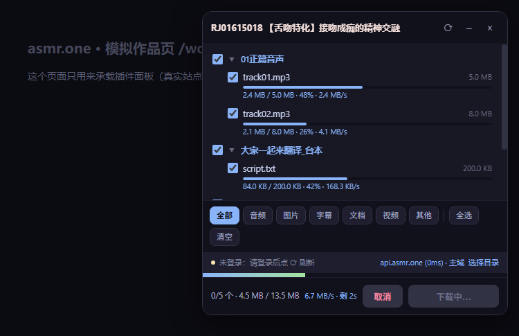
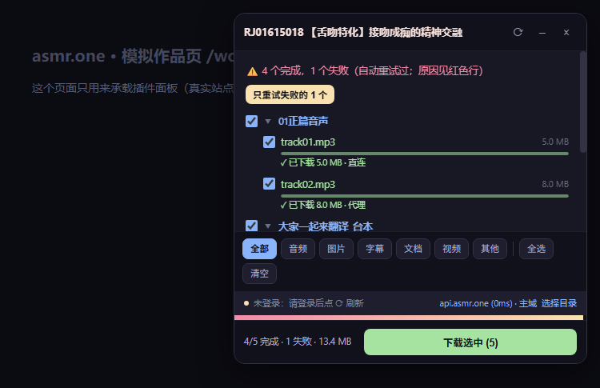
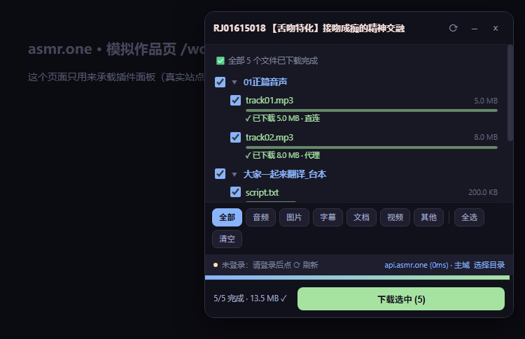

# ASMR One 批量下载器（Edge / Chrome 扩展）

给 [asmr.one](https://asmr.one) 作品页加一个面板：勾选要的文件，一键批量保存到本地，带**逐文件进度条、实时速度、失败单独重试**。

下载走 Native Messaging Host 调系统 `curl` 直写磁盘——不弹保存对话框、不改浏览器全局设置、目标目录随便挑。



## 功能

- **文件树 + 三态勾选**：勾文件夹 = 勾选其下全部文件；点名称或箭头折叠；按 音频 / 图片 / 字幕 / 文档 / 视频 过滤
- **保存结构**：`目标目录 / RJ号+标题 / 网站原有目录结构 / 文件`
- **逐文件进度**：每行一条细进度条 + `已下 / 总大小 · 百分比 · 实时速度`；完成变绿打勾并标注走的「直连 / 代理」，失败变红**直接显示 curl 原始原因**
- **总进度**：底部进度条按字节计算（下载中蓝色、停滞转黄、有失败转红），脚注显示 `完成数/总数 · 已下/总量 · 总速度 · 剩余时间`
- **失败单独重试**：收尾横幅里有「只重试失败的 N 个」，已完成的文件不会重下
- **并发与重试**：后台并发 3 个 curl，单个文件失败自动重试 3 次；「取消」随时中止
- **断线恢复**：Host 独立于浏览器运行，页面刷新/面板关闭都不影响下载；扩展重连后自动同步任务状态
- **登录态复用**：自动读取页面 `localStorage` 里的 jwt，带上 Bearer 头（不碰账号密码）



## 环境要求

| 项 | 要求 |
|---|---|
| 系统 | Windows 10 / 11（Host 用 `reg` 写注册表，**仅 Windows**） |
| 浏览器 | Microsoft Edge 或 Chrome（Chromium 内核，支持 Manifest V3 的版本） |
| Node.js | 18+（Host 用 node 运行，需在 PATH 里） |
| curl | Windows 10 1803+ 自带 `C:\Windows\System32\curl.exe`，无需另装 |

## 安装

### 1. 下载代码

```bash
git clone https://github.com/JL-Fei/asmr-one-downloader.git
cd asmr-one-downloader
```

也可以点右上角 Code → Download ZIP 解压。

### 2. 加载扩展

1. 浏览器打开 `edge://extensions`（Chrome 是 `chrome://extensions`）
2. 左下角打开 **「开发人员模式」**
3. 点 **「加载解压缩的扩展」**，选择本文件夹（就是含 `manifest.json` 的那层）
4. 在扩展卡片上点「详细信息」，**复制扩展 ID**（32 位 a–p 字母）

> 扩展 ID 由文件夹路径推导，**每个人不一样**，下一步必须填你自己的。

### 3. 安装下载 Host（一次性）

在仓库目录里打开命令行（PowerShell / cmd 都行）：

```bash
node install.js <你的扩展ID>
```

或双击 `install.bat`，把 ID 作为参数粘贴进去。

成功会打印「注册表写入成功」；它会顺带注册 Chrome（可选，失败不影响 Edge）。

### 4. 完成

- 回 `edge://extensions` 点扩展的「重新加载」
- 打开任意作品页 → 右上角出现面板 → 点「选择目录」设个保存位置（如 `D:\Downloads\asmr`）
- 勾选文件 → 「下载选中」



## 工作原理

```
作品页 (content.js) --fetch--> api.asmr.one /api/tracks/{id}?v=2    ← 拿文件树与直链
        │
        └--chrome.runtime--> background.js（并发/重试/状态）
                                  │
                                  └--nativeMessaging--> host/native-host.js
                                                              └--curl.exe -o <绝对路径>
```

### API 择台：直连优先，慢了才换台

站点有多个 API 镜像（`api.asmr.one`、`api.asmr-100/200/300.com`）。插件并行探 `/api/health?cache=false`：

- **主域活着且探活 ≤1.2s → 就用主域**（哪怕镜像更快——平时它本来就能直连，没必要绕）
- 主域探活慢或挂 → 退到最快镜像
- 主域的**真实请求**超过 2.5s → 判「慢」，**5 分钟内连探活都不再选它**，之后新开页面会自动回主域试
- 面板右下角显示 `域名 (延迟) · 主域/镜像`，点它或 ⟳ 可以手动重探

### 下载路线：直连优先，代理兜底

- 媒体域（`raw.kiko-play-niptan.one`）**先直连**，失败再上代理——国内多数时候媒体 CDN 是通的，走代理反而慢、还多一个故障点
- 其它域名代理优先、失败再直连
- Host 启动任务前会先 **TCP 探一下代理端口有没有在听**：没开就直接直连（以前写死 `-x socks5h://...`，代理一停每个文件都秒失败 `curl: (7)`）
- 传输类错误（exit 6/7/16/18/28/35/52/55/56/92）自动换下一条路线；服务器不吃 Range（exit 33）自动删残件重下

默认代理是 `socks5h://127.0.0.1:7892`，改这里：

```js
// host/native-host.js
const DEFAULT_PROXY = 'socks5h://127.0.0.1:7892';
```

### 目录选择器

第一次运行会让你设一个保存目录，之后会记在 `chrome.storage.local` 里，也可以收藏多个目录切换。

## 常见问题

| 现象 | 原因 / 处理 |
|---|---|
| 面板显示「无可用服务器」 | 站点或 `api.*` 被墙了：开代理后点 ⟳；国内平时一般直连即可 |
| 每个文件都失败 `curl: (7)` | 代理没启动。现在会自动直连兜底；如果直连也不通，就先开代理 |
| 失败 `curl: (22) 404` | 文件已从站点删除 / 直链过期，重新点 ⟳ 刷新列表 |
| 失败 `SIZE_MISMATCH` | 站点返回的大小和实际下载大小不一致（常见于站点那边文件被替换），重试或手动确认 |
| 下载完是 0 字节 | 站点本身放了「诱饵/占位」空文件，属正常现象 |
| 「下载选中」没反应 | 老版本的目录选择器 bug（2026-10-25 已修），更新到最新代码并重载扩展 |
| 改了代码不生效 | `edge://extensions` 必须点「重新加载」；Host 改动则杀掉 `node ...native-host.js` 进程让浏览器重连 |

## 开发与调试

- 面板：面板上右键 → 检查 → Console（前缀 `[asmr-dl]`）
- 后台：`edge://extensions` → 扩展卡片「服务工作进程」
- Host：直接 `node host\native-host.js`，按 native messaging 协议（4 字节小端长度 + JSON）喂消息
- 改 `API_HOSTS` 时**同步改 `manifest.json` 的 `host_permissions`**，否则内容脚本的 fetch 会被挡

## 卸载

```bash
reg delete "HKCU\Software\Microsoft\Edge\NativeMessagingHosts\com.asmr.downloader" /f
```

再到 `edge://extensions` 移除扩展。

## 更新日志

### v4.3 / manifest 1.1.0（2026-10-25）
- 新增逐文件进度条、实时速度、完成标注（直连/代理）、失败原因直显
- 总进度改为按字节、停滞变黄、收尾有失败变红；脚注显示总速度与剩余时间
- 新增「只重试失败的 N 个」
- 修复：Host 写死 SOCKS5 代理，代理没开时**所有下载必然失败**（`curl: (7)`）
- 修复：目录选择器里输入新目录后点「开始下载」无反应（重渲染丢失 await 的 promise）
- 调整：API 择台改为直连优先、慢了才换镜像

## 免责声明

本工具只负责「把你账号本来就能访问的文件更省事地存到本地」。请自行确认内容合法、并遵守站点条款与当地法律；不要用于传播或商用未获授权的作品。

## 许可

[MIT](LICENSE)
